# WebShield — SQL Injection & XSS Demonstration and Prevention Platform

WebShield is an educational full-stack web application (Flask + SQLite + HTML/CSS/JS) that shows **how SQL Injection
and Cross-Site Scripting happen and how to prevent them**, by running an *intentionally vulnerable* implementation
side by side with a *secure* one.

> ⚠ **Educational use only.** All vulnerable demonstrations run locally on `127.0.0.1`, against fictional data, in
> isolated sandboxes. Never deploy this application to a public network and never target real systems.

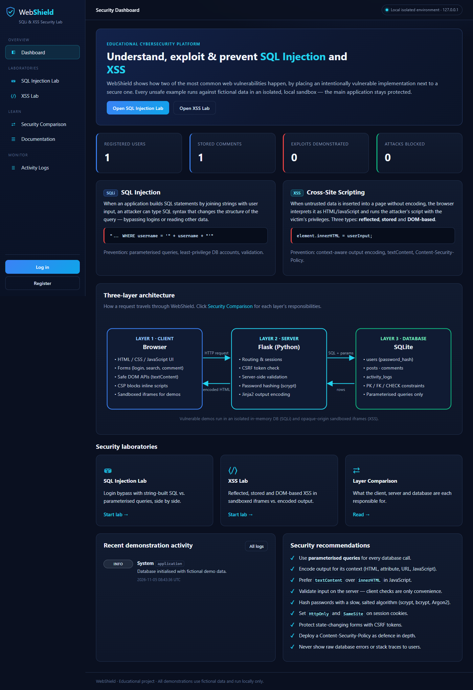

---

## 1. Features

| Module | What it does | Location |
|---|---|---|
| A · Dashboard | Intro, SQLi/XSS overview, architecture diagram, labs, recent activity, recommendations | `/` |
| B · Authentication | Register, login, logout, sessions, scrypt hashing, server-side validation, CSRF | `/register`, `/login` |
| C · SQL Injection Lab | Same input sent to a string-concatenated query and a parameterised query | `/sqli/` |
| D · XSS Lab | Reflected, stored and DOM-based XSS: sandboxed unsafe render vs. encoded render | `/xss/` |
| E · Security Comparison | Responsibilities of client / server / database + data-flow diagram | `/security` |
| F · Activity Logs | Demonstration type, time, implementation, outcome, explanation (filterable) | `/logs/` |
| G · Documentation | Definition, mechanism, location, danger, demo, prevention, real-world examples | `/docs` |

---

## 2. Installation and running (Windows, macOS, Linux)

Requirements: **Python 3.10+** (tested on Python 3.14, Flask 3.1).

```bash
cd WebShield
python -m venv .venv
```

Activate the virtual environment:

```bash
.venv\Scripts\activate
```
(macOS / Linux: `source .venv/bin/activate`)

```bash
pip install -r requirements.txt
```

```bash
python -m database.init_db
```

```bash
python app.py
```

Open **http://127.0.0.1:5000** in your browser.
Fictional demo account: **`demo_student` / `DemoPass123`** (or register your own).

`python -m database.init_db` resets the database at any time. If you skip it, the database is created automatically
on first start.

### Running the automated tests

```bash
python -m pytest -v
```

Each run regenerates **[docs/TEST_REPORT.md](docs/TEST_REPORT.md)** (test ID, input, expected, actual, pass/fail),
built from the actual outcomes — a test can't be reported as passed unless it ran. Tests use a temporary database
and never touch `database/webshield.db`.

### Regenerating the screenshots (optional)

```bash
pip install -r requirements-dev.txt
python docs/take_screenshots.py
```

With the app running, this drives Microsoft Edge/Chrome through every module, saves the PNGs to `docs/screenshots/`,
and checks in a real browser that injected scripts run **only** inside the sandbox. It also confirms the session
cookie can't be read from JavaScript.

---

## 3. Project structure

```
WebShield/
├── app.py                    # Flask app factory, CSP & security headers, error handlers
├── config.py                 # Secret key, cookie flags, session lifetime, DB path, host
├── requirements.txt          # Flask, pytest
├── requirements-dev.txt      # playwright (screenshots only)
├── database/
│   ├── schema.sql            # Tables, PK/FK/UNIQUE/CHECK constraints
│   ├── db.py                 # Per-request connection, init + fictional seed data
│   └── init_db.py            # CLI: python -m database.init_db
├── routes/                   # SERVER LAYER (Flask blueprints)
│   ├── auth.py               # register / login / logout (secure)
│   ├── dashboard.py          # dashboard, security comparison, documentation
│   ├── sqli.py               # SQL Injection lab controller
│   ├── xss.py                # XSS lab + isolated /xss/sandbox/* pages
│   └── logs.py               # activity log viewer
├── security/                 # Security logic used by the main app
│   ├── validation.py         # server-side validation + SQLi indicator detection
│   ├── password.py           # scrypt hashing (werkzeug)
│   ├── safe_rendering.py     # HTML encoding + XSS indicator detection
│   ├── csrf.py               # synchroniser-token CSRF protection
│   ├── auth_guard.py         # @login_required
│   └── logger.py             # activity logging (no secrets)
├── vulnerable/               # !!! INTENTIONALLY VULNERABLE CODE (isolated) !!!
│   └── sqli_sandbox.py       # in-memory DB, read-only authorizer, vulnerable vs secure login
├── templates/                # CLIENT LAYER (Jinja2, auto-escaped)
│   ├── base.html, dashboard.html, login.html, register.html, sqli_lab.html,
│   ├── xss_lab.html, security_comparison.html, activity_logs.html, documentation.html
│   └── vulnerable/           # !!! unsafe templates, served ONLY with CSP sandbox !!!
│       ├── reflected.html, stored.html, dom.html
├── static/css/style.css      # dark navy / cyan theme, responsive
├── static/js/main.js         # safe DOM code (textContent only)
├── tests/                    # pytest: test_auth.py, test_sqli.py, test_xss.py, conftest.py
└── docs/                     # diagrams, screenshots, test report, presentation notes
```

Intentionally vulnerable code lives **only** in `vulnerable/` and `templates/vulnerable/`, and every such file
carries a warning banner.

---

## 4. System architecture

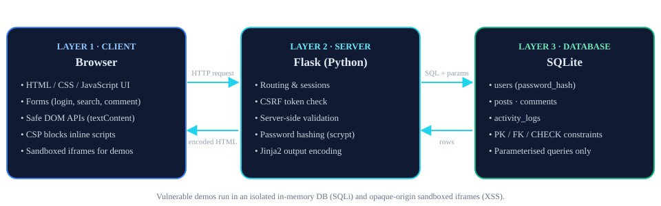

| Layer | Technology | Security responsibilities in WebShield |
|---|---|---|
| **1 · Client** | HTML5, CSS3, JavaScript | UI and forms; HTML `maxlength`/`pattern` for usability; `textContent` for untrusted data; strict CSP forbids inline scripts; unsafe demos only in `<iframe sandbox>` |
| **2 · Server** | Python 3, Flask | Routing, sessions (`HttpOnly`, `SameSite=Strict`, 30 min, regenerated at login), CSRF tokens, server-side validation, scrypt hashing, authorisation, parameterised SQL, Jinja2 output encoding, generic error pages, debug off, binds to 127.0.0.1 |
| **3 · Database** | SQLite | Relational schema with PK/FK/UNIQUE/NOT NULL/CHECK; stores only password hashes; SQLi lab uses a separate read-only in-memory DB |

Request flow: browser → (HTTP + CSRF token) → Flask validates → parameterised SQL → SQLite → rows → Jinja2 encodes
→ HTML + CSP → browser renders with safe DOM APIs.

## 5. Database schema

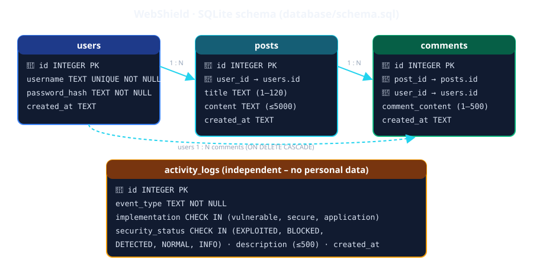

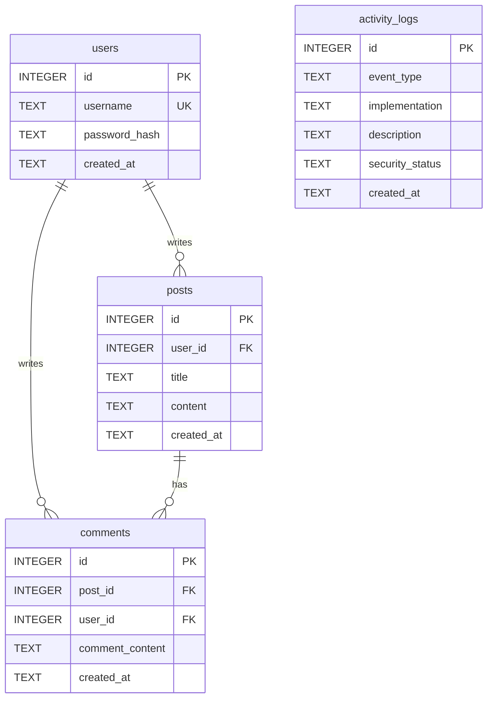

`activity_logs.implementation` (vulnerable / secure / application) was added to the required columns so each
entry shows which implementation produced it, as Module F asks.

---

## 6. How the labs are isolated

### SQL Injection lab
* `vulnerable_login()` builds SQL with string formatting; `secure_login()` uses `?` placeholders.
* Both run against a **fresh in-memory SQLite database** built for each request, holding three fictional accounts
  stored as SHA-256 hashes. The real `webshield.db` is never opened (test SQLI-13 shows that `UNION ... FROM users`
  fails).
* A SQLite **authorizer** allows only `SELECT`/read operations (no INSERT, DROP, ATTACH, PRAGMA or recursive CTEs),
  a **progress handler** stops long-running queries, and `sqlite3.execute()` rejects stacked statements.
* Inputs are capped at 200 characters. Users only see generic error messages, never raw database errors.

### XSS lab
* The **secure** output is rendered in the main page by Jinja2 auto-escaping (and `textContent` for DOM-based XSS).
* The **unsafe** output is served only from `/xss/sandbox/*`, which:
  * is embedded as `<iframe sandbox="allow-scripts allow-modals">` (no `allow-same-origin`), so it runs in an
    **opaque origin**;
  * sends its own `Content-Security-Policy: sandbox allow-scripts allow-modals; connect-src 'none'; img-src data:; form-action 'none'`,
    so it stays sandboxed even if opened directly and can't make network requests.
* The main application sends `script-src 'self'` with no `'unsafe-inline'`, so an injected script would be blocked
  even if encoding failed. Session cookies are `HttpOnly`.

---

## 7. Demonstration guide

| Lab | Input | Vulnerable result | Secure result |
|---|---|---|---|
| SQLi | `alice` / `Wonderland1` | logs in | logs in |
| SQLi | `' OR '1'='1' --` / anything | **bypass** as alice | refused |
| SQLi | `lab_admin' --` / anything | **bypass** as administrator | refused |
| SQLi | `x' UNION SELECT 1, sqlite_version(), 'injected' --` | attacker-chosen row returned | refused |
| SQLi | `O'Brien` | syntax error (breaks for legitimate names too) | handled correctly |
| Reflected XSS | `<script>alert('XSS')</script>` | alert in sandbox | shown as text |
| Stored XSS | `` | runs for every viewer (sandbox) | shown as text |
| DOM XSS | `` | `innerHTML` runs handler | `textContent` shows text |

Example buttons on each lab page fill in these inputs. Every run appears in **Activity Logs**.

---

## 8. Testing summary

`python -m pytest -v` runs **39 automated test cases** (12 authentication, 14 SQL Injection, 13 XSS). All 39 passed on
the latest run — see [docs/TEST_REPORT.md](docs/TEST_REPORT.md). They cover normal login, invalid login, special
characters, injection strings, vulnerable vs. secure comparison, query-structure verification, normal/HTML/script
comments, stored, reflected and DOM rendering, CSRF, cookie flags, CSP, authorisation, validation, and logging
without passwords.

Browser-level checks (`docs/take_screenshots.py`) also passed. The DOM payload fired an alert inside the sandbox, the
secure panel showed the payload as text, the main page DOM was unaffected, and `document.cookie` was empty.

## 9. Screenshots

| | |
|---|---|
| 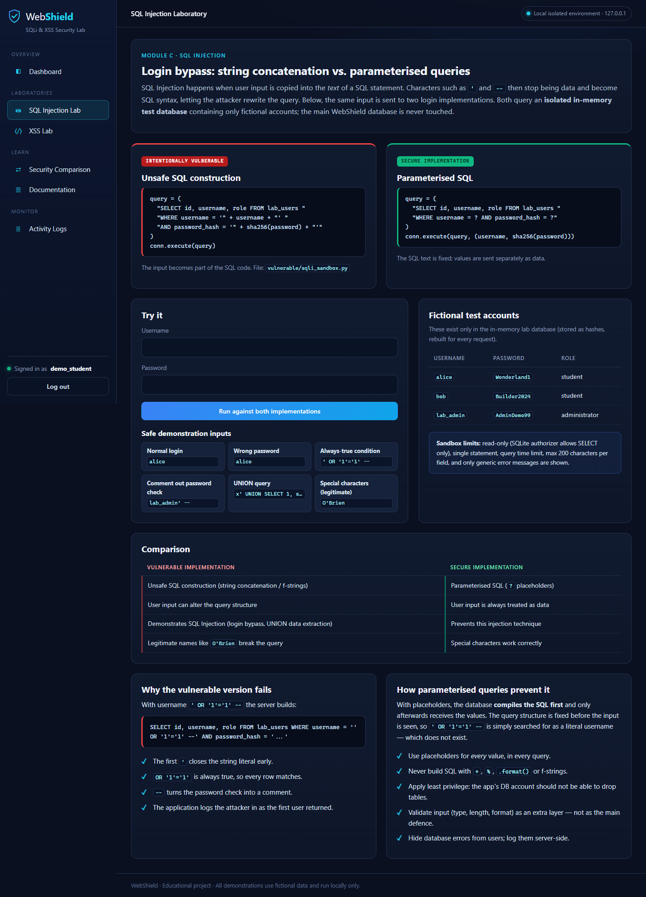 SQLi lab | 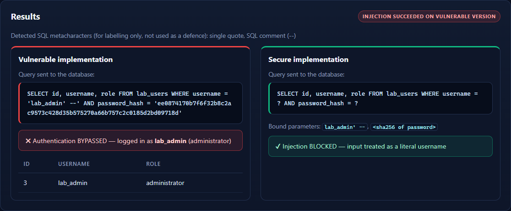 Injection result |
| 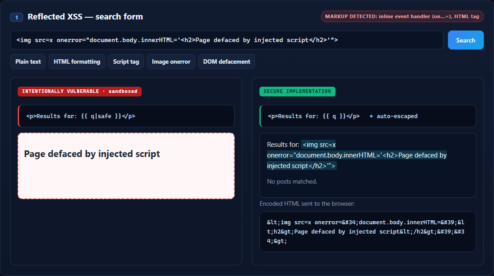 Reflected XSS | 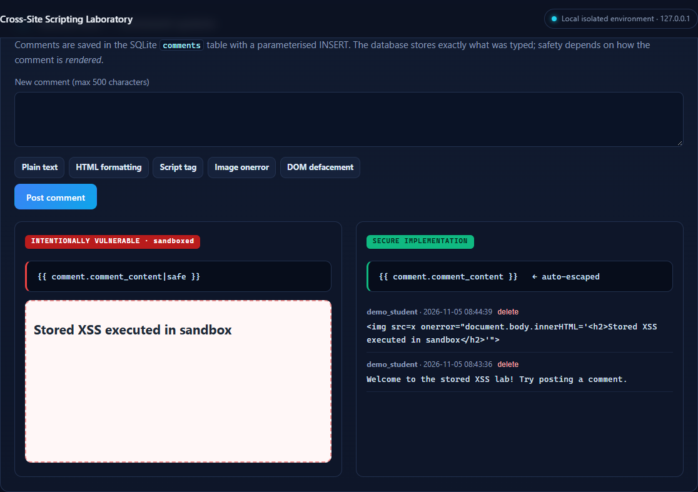 Stored XSS |
| 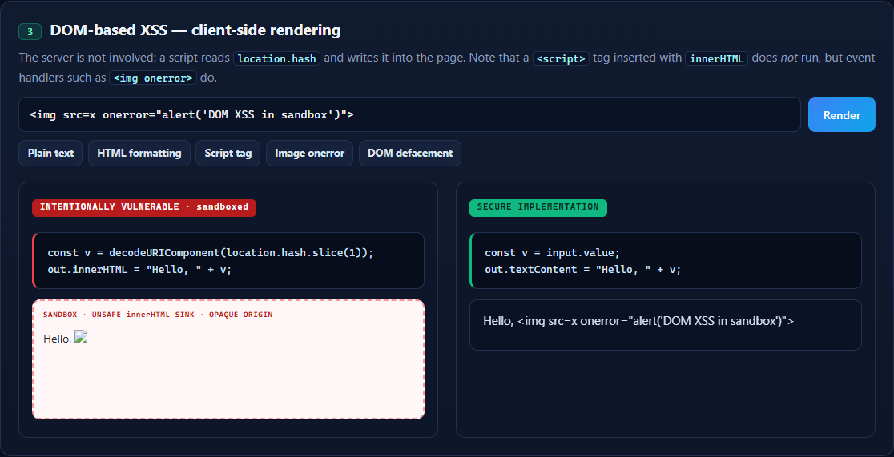 DOM XSS | 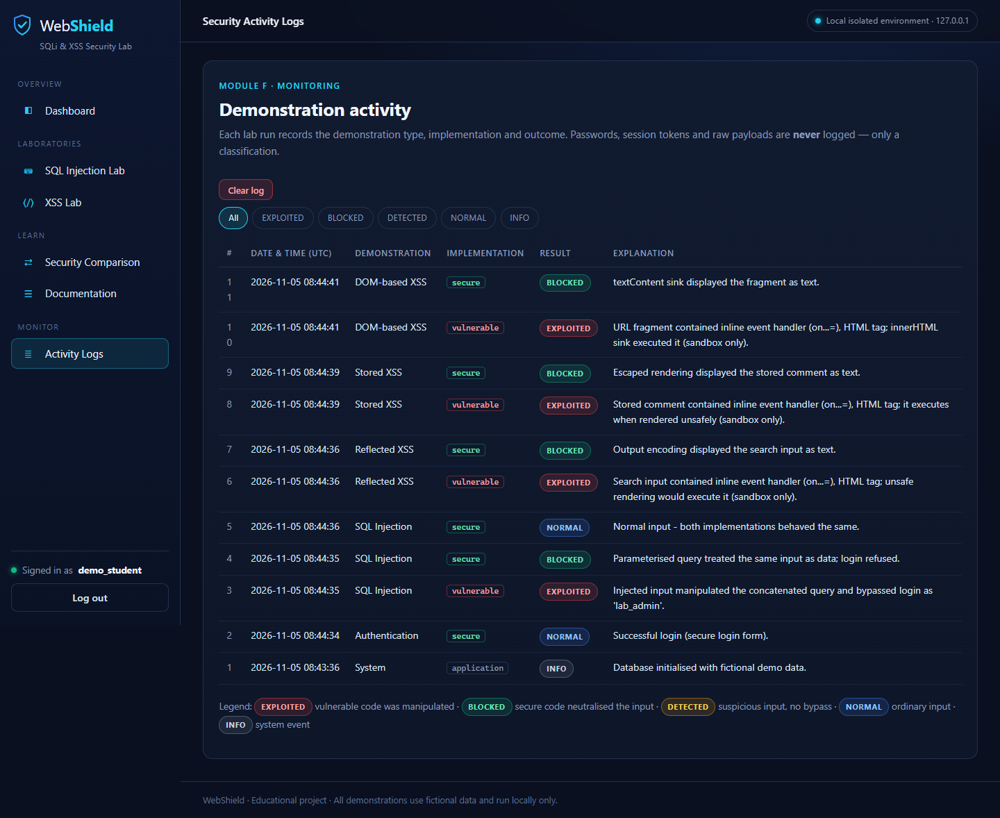 Activity logs |
| 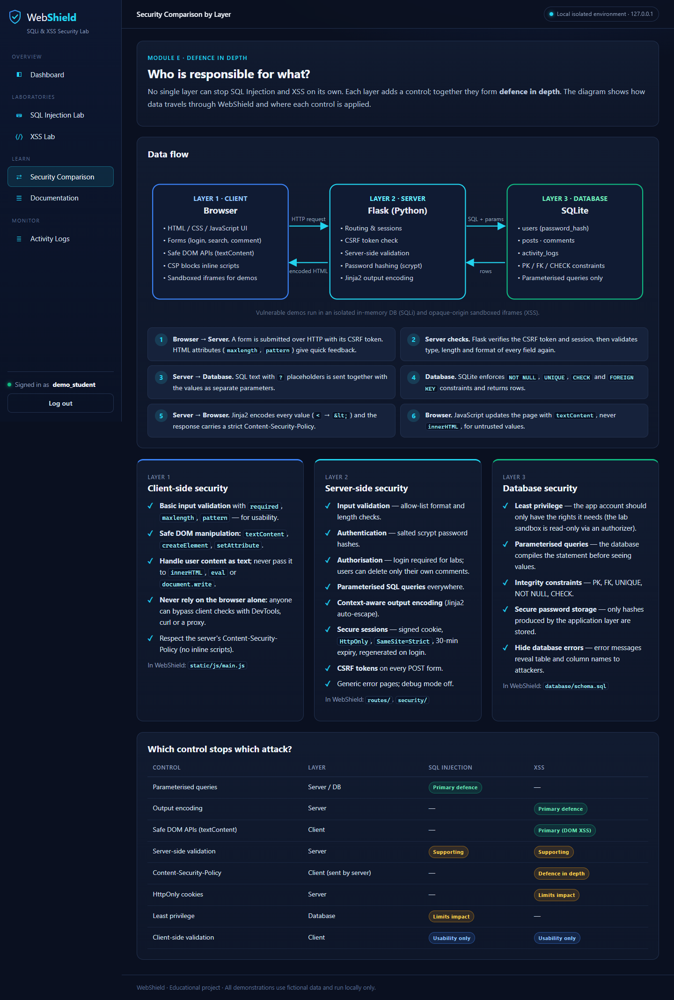 Layer comparison | 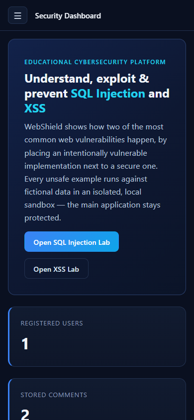 Mobile layout |

## 10. Presentation notes

See [docs/PRESENTATION.md](docs/PRESENTATION.md) for a short technical explanation and talking points.

## 11. Known limitations

* The built-in SECRET_KEY is regenerated on every restart, which logs everyone out. Set `WEBSHIELD_SECRET_KEY` to keep sessions.
* `SESSION_COOKIE_SECURE` is `False` because the local server uses HTTP. Set it to `True` behind HTTPS.
* SQLite has no user accounts, so least privilege is shown with the sandbox authorizer rather than database roles.
* There is no login rate limiting. A production system should add it.
